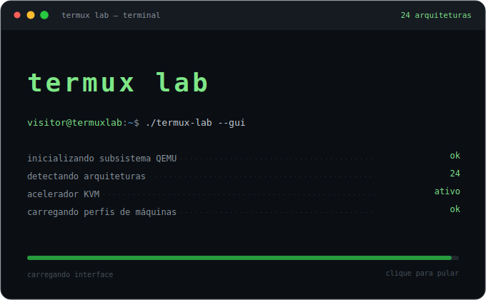
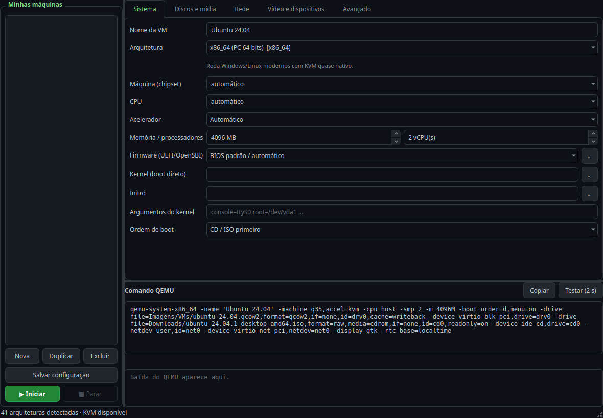
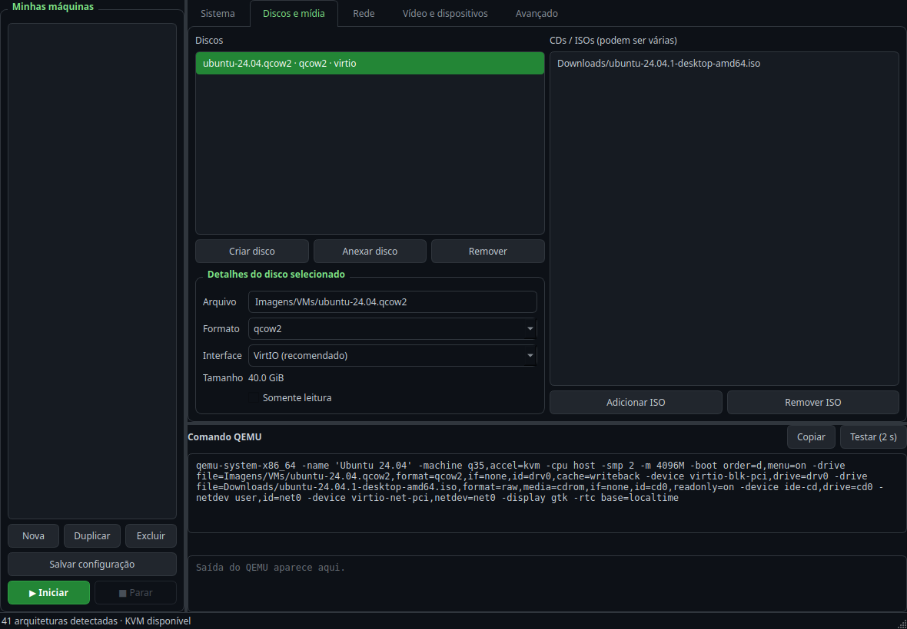
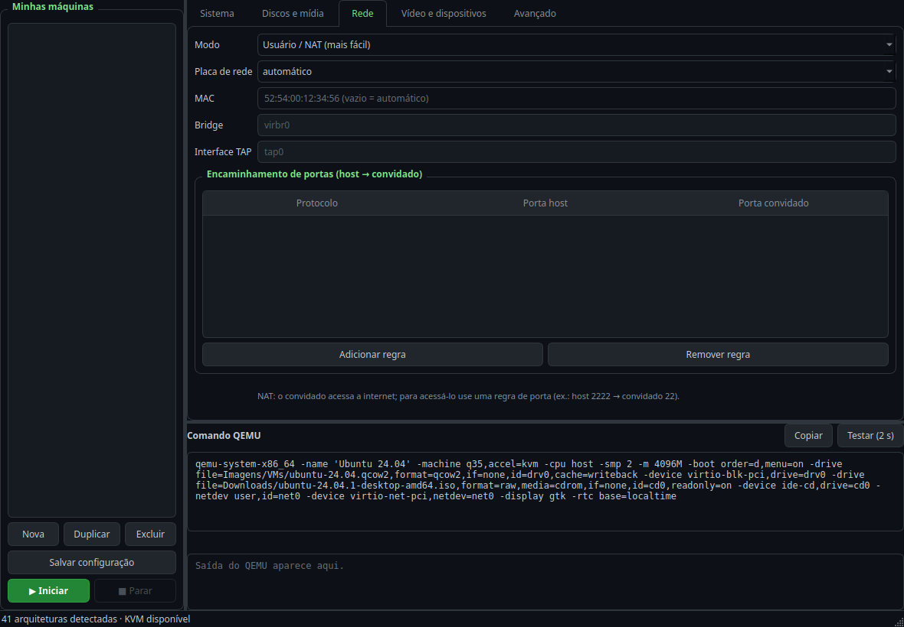

# Termux Lab

> Virtualizador QEMU com interface gráfica: escolha a arquitetura, ajuste o que
> quiser e veja o comando pronto — sem decorar flags.



[](#requisitos)
[](#requisitos)
[](#requisitos)
[](#licença)
[](#requisitos)

O **Termux Lab** é uma interface em Python/PyQt6 que monta a linha de comando do
QEMU para você. Em vez de caçar a sintaxe de `-drive`, `-device`, `-netdev` e
`-machine`, você escolhe opções em formulários, vê o comando sendo atualizado em
tempo real e inicia a máquina com um clique.



---

## Índice

- [O que ele faz](#o-que-ele-faz)
- [Requisitos](#requisitos)
- [Instalação](#instalação)
- [Uso em 5 passos](#uso-em-5-passos)
- [Guia por aba](#guia-por-aba)
- [Receitas prontas](#receitas-prontas)
- [Arquiteturas](#arquiteturas)
- [Atalhos](#atalhos)
- [Onde ficam os arquivos](#onde-ficam-os-arquivos)
- [Solução de problemas](#solução-de-problemas)
- [Estrutura do projeto](#estrutura-do-projeto)
- [Contribuindo](#contribuindo)
- [Créditos](#créditos)
- [Licença](#licença)
- [Guia detalhado de uso](docs/como-usar.md)
- [Publicando no GitHub](docs/publicar-no-github.md)

## O que ele faz

- **Detecta o QEMU instalado**: arquiteturas, máquinas (`-machine`), CPUs
  (`-cpu`), backends de vídeo, aceleradores e firmwares são lidos do próprio
  binário — nada fica chumbado no código.
- **Aceleração automática**: usa KVM quando a arquitetura é a nativa da sua
  máquina; nas outras, cai para emulação (TCG) avisando na tela.
- **Discos** criados com `qemu-img` (qcow2, raw, vmdk, vdi, vhdx…) ou anexados
  de qualquer lugar, com interface VirtIO, virtio-scsi, IDE ou USB.
- **Mídia**: várias ISOs ao mesmo tempo, com o controlador correto para cada
  arquitetura (IDE no x86, virtio-scsi nas demais).
- **Rede**: NAT com encaminhamento de portas, bridge ou TAP; modelo de placa e
  MAC configuráveis.
- **Vídeo**: janela GTK, SDL, VNC ou sem janela; `virtio-gpu` automático nas
  arquiteturas não-x86.
- **Extras**: console serial com campo para digitar dentro da VM, tablet USB,
  áudio, modo snapshot, relógio local, pasta compartilhada 9p, UEFI/OVMF com
  NVRAM própria por máquina e argumentos crus do QEMU.
- **Perfis salvos**, última VM aberta e tamanho da janela são lembrados.
- **Testar (2 s)**: sobe a VM sem tela por dois segundos e avisa se o QEMU
  reclamou da configuração.
- **Copiar**: o comando completo vai para a área de transferência.

## Requisitos

| Item | Versão mínima | Observação |
|---|---|---|
| Linux | — | testado em Ubuntu/Debian; usa `/dev/kvm` |
| Python | 3.10 | usa `dataclasses`, `X \| None` |
| PyQt6 | 6.2 | interface gráfica |
| QEMU | 6.0 | `qemu-system-*` + `qemu-img` no `PATH` |
| KVM | opcional | `/dev/kvm` acessível ao seu usuário |

```bash
sudo apt install qemu-system-x86 qemu-img python3-pyqt6
# arquiteturas extras (ARM, PowerPC, s390x, MIPS, SPARC, outros):
sudo apt install qemu-system-arm qemu-system-ppc qemu-system-s390x \
                 qemu-system-mips qemu-system-sparc qemu-system-misc
# firmwares UEFI:
sudo apt install ovmf qemu-efi-aarch64 opensbi
```

## Instalação

```bash
git clone https://github.com/agmarthur/termux-lab.git
cd termux-lab
./vitualizador.sh
```

Sem clonar, basta baixar a pasta e rodar:

```bash
cd "/caminho/para/vitualizador"
python3 -m vitualizador
```

Para aparecer no menu de aplicativos:

```bash
cp vitualizador.desktop ~/.local/share/applications/
chmod +x vitualizador.sh
```

O arquivo `.desktop` usa caminho absoluto no campo `Exec=`. Se a pasta estiver
em outro lugar, edite essa linha antes de copiar.

Verificação rápida sem abrir a janela (gera e valida comandos para todas as
arquiteturas instaladas):

```bash
python3 -m vitualizador --selftest
```

## Uso em 5 passos

1. **Nova** → dê um nome à máquina.
2. **Sistema**: escolha a arquitetura (x86_64 para Windows/Linux comuns), a
   memória e os processadores.
3. **Discos e mídia**: crie um disco qcow2 e adicione a ISO do instalador.
4. **Rede** (opcional): deixe em NAT e adicione uma regra de porta se quiser
   acessar SSH/HTTP do convidado.
5. Clique em **▶ Iniciar**. A janela do QEMU abre. Quer só o comando? Copie o
   texto do painel **Comando QEMU**.

> Antes de iniciar, use **Testar (2 s)**. Ele sobe a máquina sem tela por dois
> segundos e mostra no log qualquer erro de configuração.

## Guia por aba

### Sistema

| Campo | O que faz |
|---|---|
| Arquitetura | escolhe o binário `qemu-system-*` |
| Máquina (chipset) | `-machine`; `q35` é o padrão recomendado em x86_64 |
| CPU | `-cpu`; automático usa `host` no KVM e `max` no TCG |
| Acelerador | Automático / KVM / TCG |
| Memória e processadores | `-m` e `-smp` |
| Firmware | BIOS padrão, UEFI/OVMF/AAVMF, OpenSBI ou arquivo seu |
| Kernel / Initrd / Argumentos | boot direto de kernel, sem firmware |
| Ordem de boot | CD/ISO, disco ou rede (PXE) |

### Discos e mídia



- **Criar disco**: abre o diálogo, cria com `qemu-img` e anexa.
- **Anexar disco**: usa a imagem existente (formato detectado automaticamente).
- **Interface**: `VirtIO` é a mais rápida; `SCSI` é a mais compatível; `IDE` só
  existe em máquinas x86; `USB` é o curinga.
- **CDs / ISOs**: pode empilhar quantas quiser.

### Rede



| Modo | Quando usar |
|---|---|
| Sem rede | máquina isolada |
| Usuário / NAT | acesso à internet sem configuração; use regras de porta para entrada |
| Bridge | convidado na mesma rede do host (precisa de bridge existente) |
| TAP | rede manual, para topologias próprias |

Cada regra é `host:porta → convidado:porta`. Ex.: `2222 → 22` permite
`ssh -p 2222 usuario@127.0.0.1`.

### Vídeo e dispositivos

Saída de vídeo (GTK/SDL/VNC/sem janela), placa de vídeo, console serial
(`nographic`, com campo para digitar no painel de log), tablet USB, áudio,
snapshot (descarta alterações ao desligar), relógio local, menu de boot e pasta
compartilhada 9p.

Para montar a pasta compartilhada dentro de um Linux convidado:

```bash
sudo mount -t 9p -o trans=virtio,version=9p2000.L hostshare /mnt
```

### Avançado

Argumentos crus repassados ao QEMU, um por linha ou separados por espaço —
útil para dispositivos específicos, por exemplo um pendrive físico:

```
-device usb-host,vendorid=0x0781,productid=0x5567
```

## Receitas prontas

### Ubuntu / Debian / Fedora (x86_64)

Arquitetura `x86_64`, máquina `q35`, 4096 MB, 2 vCPU, disco VirtIO qcow2 de
40 GB, ISO anexada, boot `CD / ISO primeiro`. Depois de instalar, mude para
`Disco primeiro`.

### Windows 11

Arquitetura `x86_64`, `q35`, 8192 MB, 4 vCPU, firmware **UEFI/OVMF**, disco
VirtIO 64 GB, ISO do Windows, rede `virtio-net-pci`.

O Windows 11 exige TPM 2.0. Use *Avançado → argumentos extras*:

```
-chardev socket,id=chrtpm,path=/tmp/swtpm.sock
-tpmdev emulator,id=tpm0,chardev=chrtpm
-device tpm-tis,tpmdev=tpm0
```

E crie o socket antes de iniciar:

```bash
mkdir -p /tmp/emulated_tpm
swtpm socket --tpmstate dir=/tmp/emulated_tpm --ctrl type=unixio,path=/tmp/swtpm.sock --tpm2 --daemon
```

Se o instalador não enxergar o disco, troque a interface para `SCSI` e adicione
o driver VirtIO/SCSI pela ISO de drivers da virtio-win.

### Alpine Linux (teste rápido)

Arquitetura `x86_64`, 1024 MB, disco VirtIO 2 GB, ISO `alpine-virt`, boot
`CD / ISO primeiro`.

### ARM64 (ISO)

Arquitetura `aarch64`, máquina `virt`, firmware **UEFI / AAVMF**, disco VirtIO.
Sem firmware ARM o ISO não inicia.

### RISC-V

Arquitetura `riscv64`, máquina `virt`, OpenSBI automático (padrão). O caminho
mais simples é boot direto de kernel: preencha *Kernel*, *Initrd* e
`console=ttyS0 root=/dev/vda`.

### Boot direto de kernel (qualquer arquitetura)

Preencha kernel, initrd e argumentos; o firmware deixa de ser necessário e o
boot fica bem mais rápido.

## Arquiteturas

O app lista apenas o que está instalado — a barra lateral mostra o que falta.

| Arquitetura | Binário | Melhor uso |
|---|---|---|
| x86_64 | `qemu-system-x86_64` | Windows, Linux e BSD modernos com KVM |
| i386 | `qemu-system-i386` | sistemas 32 bits antigos (DOS, Win9x) |
| aarch64 | `qemu-system-aarch64` | Linux ARM64 + UEFI (AAVMF) |
| arm | `qemu-system-arm` | ARM 32 bits, placas `virt` |
| riscv64 / riscv32 | `qemu-system-riscv64` / `-riscv32` | Linux RISC-V, OpenSBI |
| ppc64 / ppc64le | `qemu-system-ppc64` | PowerPC (pseries) |
| s390x | `qemu-system-s390x` | IBM Z (ccw-virtio) |
| loongarch64 | `qemu-system-loongarch64` | LoongArch `virt` |
| m68k, hppa, alpha, sh4, cris, microblaze, nios2, or1k, rx, tricore, xtensa, avr | variados | emulação didática; muitas exigem kernel/ROM |

> KVM só acelera a arquitetura nativa do seu computador. As demais rodam em
> TCG (emulação por software) — funcionam, mas com desempenho bem menor.

## Atalhos

| Tecla | Ação |
|---|---|
| `Ctrl+N` | nova máquina |
| `Ctrl+S` | salvar configuração |
| `F5` | iniciar |
| `Shift+F5` | parar |

## Onde ficam os arquivos

| Conteúdo | Caminho |
|---|---|
| Perfis das VMs | `~/.config/vitualizador/vms/*.json` |
| Imagens de disco (padrão) | `~/Imagens/VMs` (ou `~/VMs`) |
| NVRAM do UEFI por VM | `~/.local/share/vitualizador/nvram/*.fd` |
| Ícones do tema | `~/.cache/termux-lab/*.svg` |

Os perfis são JSON legíveis — dá para versionar ou editar à mão.

## Solução de problemas

**A VM inicia muito devagar / diz TCG no log**
KVM não está disponível para essa arquitetura (ou o usuário não tem acesso).

```bash
ls -l /dev/kvm
sudo usermod -aG kvm "$USER"   # depois saia e entre na sessão
```

**`qemu-system-x86_64: Could not access KVM kernel module`**
O módulo não está carregado ou a virtualização está desligada na BIOS.

```bash
lsmod | grep kvm
sudo modprobe kvm_intel   # ou kvm_amd
```

**Nenhuma janela abre (mas o processo roda)**
A build do QEMU pode não ter GTK. Confira e escolha outra saída:

```bash
qemu-system-x86_64 -display help
```

Use SDL, VNC (`-display vnc=:0`, depois um cliente VNC) ou sem janela com
console serial.

**A ISO não faz boot em ARM/RISC-V**
Falta firmware. Instale `qemu-efi-aarch64` / `opensbi` e selecione o firmware na
aba *Sistema*.

**Windows não encontra o disco**
Use interface `SCSI` e carregue o driver da virtio-win durante a instalação, ou
troque para `IDE`.

**Rede bridge não conecta**
A bridge precisa existir no host e o `qemu-bridge-helper` precisa estar liberado
em `/etc/qemu/bridge.conf`:

```bash
sudo ip link add br0 type bridge
sudo ip addr add 192.168.100.1/24 dev br0
sudo ip link set br0 up
echo "allow br0" | sudo tee -a /etc/qemu/bridge.conf
```

**Quero ver os erros do QEMU**
O painel inferior mostra a saída completa. O botão **Testar (2 s)** exibe os
erros mais comuns de imediato.

## Estrutura do projeto

```
vitualizador/
├── arch.py      # descoberta de arquiteturas, máquinas, CPUs e firmwares
├── model.py     # VMConfig, Disk, PortForward (serialização JSON)
├── build.py     # configuração -> linha de comando do QEMU
├── store.py     # perfis, qemu-img, caminhos
├── theme.py     # tema escuro (Fusion + QSS)
├── splash.py    # tela de abertura animada
├── ui.py        # janela principal (PyQt6)
└── __main__.py  # ponto de entrada e --selftest
```

## Contribuindo

Sugestões de VM, correções de comando e novas arquiteturas são bem-vindas.
Leia o [CONTRIBUTING.md](CONTRIBUTING.md) para o fluxo de issues, padrões de
código e como rodar as verificações antes de abrir um pull request.

## Créditos

- **K.O. (Caio Botelho)** — idealização, testes e direção do projeto.
- **o usuário** — desenvolvimento da interface e do montador de comandos.
- Comunidade QEMU, pelo emulador e pela documentação.

## Licença

Distribuído sob a licença MIT. Veja [LICENSE](LICENSE) para o texto completo.
